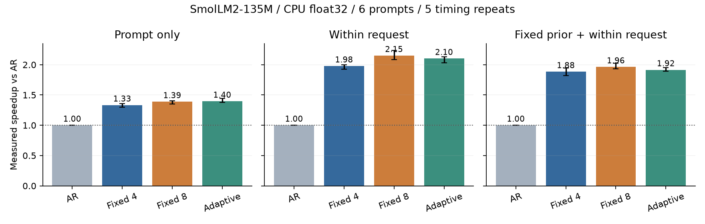
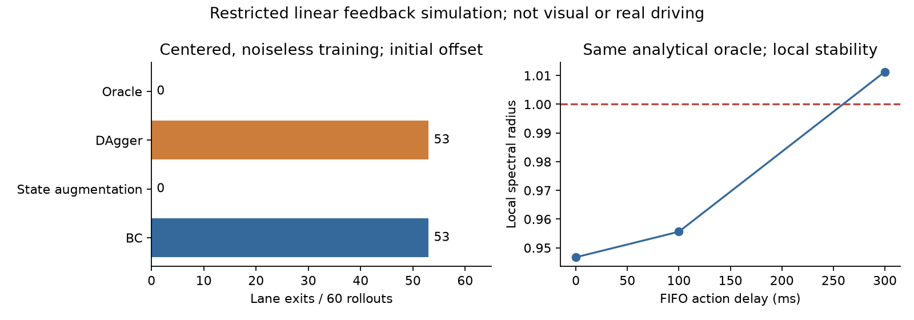

# Inference costs and feedback learning studies

Reproducible baseline experiments and literature notes on speculative decoding costs and closed-loop feedback. The project starts from two questions. When do accepted draft tokens repay the cost of proposing and checking them? What does low error on expert demonstrations tell us about recovery after a policy changes the state it visits?

The initial code, runs and report were produced with Codex in response to research questions raised by the repository owner. Execution and authorship details are in [PROVENANCE.md](PROVENANCE.md).

## Measured observations

The inference study used SmolLM2 135M, float32, SDPA attention, CPU, batch one, six diagnostic prompts and five timing repeats. All 360 measured requests matched the ordinary greedy token output. In the within-request history condition, the simple acceptance-feedback heuristic discarded fewer drafts but took 2.71 percent longer than fixed budget eight by the median paired time ratio. The six prompts and short outputs define the evaluation scope. Five timing repetitions do not increase the independent task count.

The feedback study used a linearized lane model and linear imitation policies. Exactly centered noiseless demonstrations left recovery feedback unidentifiable. BC and this two-round DAgger setup had almost zero expert-log error yet left the lane in 53 of 60 initial-offset evaluations. Oracle-relabeled state augmentation recovered the missing feedback. Under slightly excited noiseless data, BC recovered the expert too. The 7,200 evaluation rows reuse 300 unique environments. The state inputs are lateral error, heading error and road curvature.

The sampling audit provides a separate constructed case for a pinned upstream verifier. With target probability 0.8, two candidate orderings lead to derived output probabilities 0.928 and 0.768 under the inspected evaluation entry. The archived 30,000 samples per ordering support this function-level calculation. Full-model and other-entry behavior requires separate checking.





## Read the results

- [Chinese technical review](reports/technical_review_zh.md)
- [Literature evidence matrix](reports/evidence_matrix.md)
- [Inference protocol](experiments/inference/README.md)
- [Feedback protocol](experiments/driving_feedback/README.md)
- [All feedback conditions](results/driving_feedback/all_failure_results.md)

## Verify the saved inference records

The following command uses the Python standard library. It reads the archived token and round records, recomputes accounting and summary values, and reports the observed EOS coverage.

```sh
python scripts/verify_inference_results.py --results results/inference --eos-token-id 0
```

Use the EOS token ID in `sources/SmolLM2-135M/config.json`. The helper can also read that config automatically. The original batch has zero EOS cases.

## Reproduce the feedback experiment

Python 3.12 and NumPy 2.4.6 were used for the archived run. Create an isolated environment and install the small driving dependency set. From the project root run the following commands.

```sh
python -m pip install -r requirements-driving.txt
python experiments/driving_feedback/run_feedback.py --output results/driving_feedback_rerun
python experiments/driving_feedback/analyze_feedback.py --results results/driving_feedback_rerun
```

The run regenerates 600 test NPZ files and 90 training NPZ files, approximately 201 MB. Those arrays remain outside Git. The checked-in CSV, parameters and audits record the original experiment. Raw-array checks require regenerating those arrays first. Use a fresh output directory for each run.

## Reproduce the model timing experiment

Use Python 3.12. For a CPU installation, install PyTorch from its CPU wheel index before the remaining requirements.

```sh
python -m pip install torch==2.12.0 --index-url https://download.pytorch.org/whl/cpu
python -m pip install -r requirements.txt
python experiments/inference/download_model.py
python experiments/inference/rerun_benchmark.py --repeats 5 --tokens 64 --output results/inference_rerun
python scripts/verify_inference_results.py --results results/inference_rerun
```

The download retrieves roughly 269 MB of public model weights at a pinned revision and checks their SHA256. Timing boundaries include table setup, prefill and decoding after tokenization. Loading, tokenization, text decoding and disk serialization are outside that boundary. The original 360 timed requests took about 24 minutes in total, plus setup and checking. Hardware and software changes affect timing.

`rerun_benchmark.py` refuses to overwrite an existing `records.jsonl`. It leaves the measured `benchmark.py` unchanged. The latter has limited EOS diagnostics in the original unused stop cases, described in the protocol. The observed output matches establish correctness for the measured requests.

## Reproduce the upstream function audit

```sh
python scripts/run_sampling_audit.py --output results/sampling_audit_rerun.json
```

This wrapper sends new output to a chosen file and preserves the archived JSON. It runs the unmodified original audit against the unmodified pinned author utility. Third party attribution and licenses are in [THIRD_PARTY.md](THIRD_PARTY.md).

## Interpretation and next work

The present comparison uses a simple acceptance heuristic and two fixed budgets. A follow-up needs development-set budget selection, more diverse held-out workloads, controller cost, repeatable timing, and separate analysis of history sources. The driving follow-up needs paired roads and explicit observation and action timestamps before testing a visual driving policy. The technical review records related prior work and the outstanding formal-paper access gaps.
