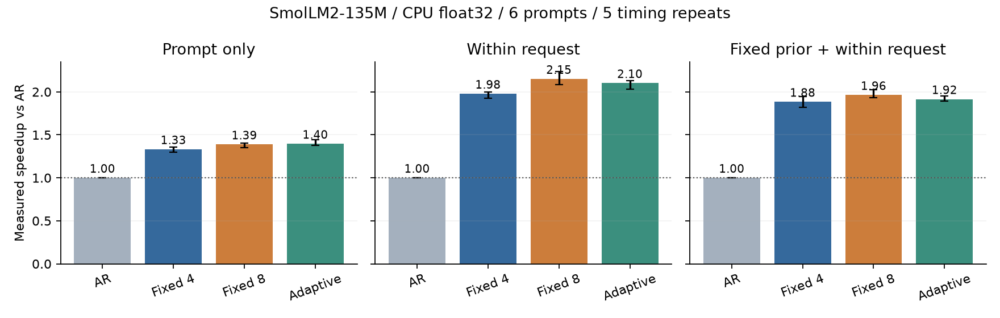
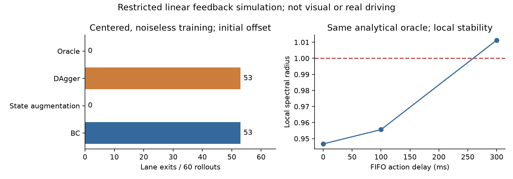

# 推测解码成本与反馈学习研究综述

本技术版由原研究档案整理。初始文献整理、代码和实验由 Codex 根据仓库所有者提出的问题生成并执行，随后完成结果审计。原始测量脚本和日志保持字节一致。原目录保留完整材料。


研究日期为 2026 年 11 月 6 日。本文讨论推测解码的收益条件，以及从观测到驾驶行动的学习与验证，记录文献分析、有限实测和待检验的问题。

**核心判断。** 草稿接受不是传统数据缓存命中。大模型仍须验证，净收益取决于实际提交量与起草、验证、状态维护的总成本；动态长度、后缀复用和硬件成本优化已有明确先行工作。驾驶学习也不能只看日志预测误差：行动改变后续观测，数据覆盖、恢复能力、延迟和评价环境共同决定闭环表现。两条研究线可以共享“计算与反馈应服务于最终任务”的问题意识，但目前没有证据要求将它们拼成一个新算法或同一博士课题。

这次研究包含原始文献与固定版本代码审计、合成轨迹回放、小型语言模型重复实测、作者采样验证函数反例、低维驾驶反馈仿真。它们支持的结论不同。本文不把论文作者的大模型结果写成本机复现，不把低维控制试验写成视觉自动驾驶成果，也不预设提出了新颖方法。


## 证据约定

- **P 论文原结论**：已发表原文的相应方法和实验；“读取相关部分”与“保存全文”分别记录。
- **A 预印本原结论**：读取指定 arXiv 版本，不能由此推断已正式录用。
- **C 代码证据**：固定版本的静态检查；只有明确标出运行记录才算执行。
- **R 本机验证**：本次实际运行并保留输入、脚本、输出及配置的验证。
- **I 本报告推论**：从材料或明示假设推导的判断。
- **F 未来问题**：尚未执行、尚未证明新颖性或尚待外部确认。


Adaptix 正式 AAAI PDF 尚未取得。相关机制分析使用作者链接的 arXiv v2 及其附录，并审计固定版本代码。

## 一 推测解码怎样产生净收益


Leviathan 等的 Algorithm 1 先用提议分布 q 自回归生成 k 个候选，目标模型 p 在候选前缀上并行算出 k+1 个条件分布。依次以 min(1,p(x)/q(x)) 接受候选；首次拒绝后，从归一化的正部 max(p-q,0) 采一个纠正 token，丢弃该点后的候选。全接受时从最后的目标分布再采一个 token。因此通常提交 A+1 个 token，其中 A 是接受前缀长度；EOS 和长度上限会截断这个数。贪心版本匹配 target argmax；随机采样保证的是分布相同，不是相同随机种子逐字同样。原论文在单 TPU-v4、batch 1 的 T5-XXL/T5X 实现测得 2–3 倍加速，不能移植成任意硬件的保证。[P，算法 1、§3–4、附录 A.1](https://proceedings.mlr.press/v202/leviathan23a/leviathan23a.pdf)

[I] 这里“拒绝后再逐个验后面的 token”一般无效：那些位置的 logits 是以错误候选为条件算出的，条件上下文已变。树验证能保留其他正确分支的已算状态，但需要正确的 ancestor-only attention mask、位置编号和 KV 状态映射。单纯把被拒绝候选删掉，再使用原来的后续 logits，会破坏目标分布或贪心一致性。

[I] 固定一轮前缀，记继续接受第 i 个候选的条件概率为 a_i，则预期提交量可以写为

E[M_k] = 1 + Σ(i=1..k) Π(j=1..i) a_j。

若以随机变量描述各前缀，应对相应的存活概率取期望；不能把所有位置的平均接受率直接相乘。这个式子揭示为什么“每个候选单独的命中率”不足够：第十个候选必须前九个都存活才有价值。

[I] 定义 D(k) 为起草与检索，V(k,l,b) 为上下文 l、batch b 下的目标验证，C 为提交及 KV 管理，H 为调度、CPU/GPU 同步等开销，则可用的近似目标是

有效生成速度 = E[实际提交 token] / E[D + V + C + H]。

这里失败工作已经在 D 和 V 中付过，不应又把同一段失败计算加到分母。可以单独标注拒绝位置之后的验证 token 数作为 wasted work，但它不是可以从一次融合 kernel 中精确拆出来的独立墙钟时间。端到端总时长还必须计入 prefill；冷加载、编译和模型下载应另列。

[I] 在独立同分布接受率 α、验证整块与普通单步同耗时、每个 draft token 耗时为单步目标的 c 倍这些理想条件下，speedup = (1+α+…+α^k)/(1+kc)。k=1 时改善条件为 α>c。去掉“整块验证时间恒定”这个前提，必须重新测量 V。更长上下文、更大 batch、小型 CPU 模型、树构造和 KV 搬运都可能改变判断。原算法减少目标调用次数，并不保证减少 FLOPs，也不保证更快。

## 二 Adaptix 的机制与代码审计

核对日为 2026 年 11 月 6 日。这里区分公开原文、当前代码、数学推论和已执行的函数级验证。本文不是作者大规模实验的复现。

### 材料与版本

[AAAI 正式记录](https://ojs.aaai.org/index.php/AAAI/article/view/34647)给出标题 Adaptive Draft-Verification for Efficient Large Language Model Decoding、作者 Xukun Liu、Bowen Lei、Ruqi Zhang、Dongkuan Xu，卷39(23)、页24668–24676，发布日期2025-04-11，方法名 Adaptix。[作者仍链接的 arXiv v2](https://arxiv.org/html/2407.12021v2)日期为2024-08-19，方法名 ADED，含附录A–I。本次已读取该预印本正文及附录、下载其PDF/HTML，并检查作者代码。正式PDF直接请求被403/Anubis阻挡，搜索索引能读部分正文，但未取得完整正式PDF；因此不能声称完成正式版逐页通读或证明正式版与v2完全相同。这是本报告的明确来源缺口，下面详细算法与表格均注明所用版本。

代码固定在 [241dad836fd71aa295a3967f7efe4cfcd2dd9609](https://github.com/liuxukun2000/Adaptix/tree/241dad836fd71aa295a3967f7efe4cfcd2dd9609)。README仍用ADED，依赖固定 transformers==4.34.1、numpy==1.26.1、accelerate==0.24.1，另有Rust/PyO3检索器。不能把当前系统的transformers 5.11与原库直接混装后宣称原论文复现。仓库已完整保存，未改动作者源文件。

### 存的是什么以及怎样更新

**代码事实。** Writer按token三元组计数，再把每个前二token键下的后继频次归一化。Reader加载时对每个键只保留最高的12个后继，不重新归一化。运行时，每次search读取传入序列最近最多16个token，将其中三元组对应值加0.04，最高截到3.0；不存在的条目也会加入。这不是“每接收一个新token只更新一次的归一化频率估计”：重叠窗口会重复加分，值可大于1，且动态新增后继不再受加载时的top-12裁剪。因此更准确地说，运行时存储的是自适应三元组权重（adaptive trigram weights）。rollout采样时会按权重和归一化，PUCT中的prior则直接使用这些值。[Reader与Writer](https://github.com/liuxukun2000/Adaptix/blob/241dad836fd71aa295a3967f7efe4cfcd2dd9609/DraftRetriever/src/lib.rs)

传入search的序列是已提交的input_ids再加上由目标模型当前logits选出的一个anchor token。因而这张表学习的是当前已知前缀和这个已确定的下一token，未把尚未验证的整条草稿当真值写入。原评估脚本在所有问题前只创建一次Reader，三次warmup也复用它，之后继续跨题目使用。于是“请求内学习”“跨请求积累”“warmup时已经见过第一题输出”在这个脚本里没有完全隔离。这个观察不证明每个论文结果有污染，但要求复现实验明确重置与数据流。[生成候选](https://github.com/liuxukun2000/Adaptix/blob/241dad836fd71aa295a3967f7efe4cfcd2dd9609/aded/model/utils.py#L78)、[评估脚本](https://github.com/liuxukun2000/Adaptix/blob/241dad836fd71aa295a3967f7efe4cfcd2dd9609/llm_judge/gen_model_answer_aded.py)

**本报告推论。** 短上下文键把许多不同真实上下文合并成同一个键。若同一个bigram在代码、自然语言或不同指令下需要不同后继，单张三元组表不可能同时精确恢复所有长上下文条件分布。更长历史、标签、回退与遗忘可能改善别名冲突，但后缀树、SAM、TAGE式历史选择和现有自适应草稿研究已覆盖这类结构，不能仅凭该动机声称新颖。

### 草稿怎样搜索

**代码事实。** Rust检索器以最后两个token为初始状态，建立MCTS并运行150轮，sentence_length=4、top_k=24。节点按累计score/visits与探索项选择，常数c1=32、c2=8；未访问节点给无穷大优先级。展开后继、按三元组归一化权重进行rollout，再更新路径上的visit与score。最后收集树中前缀，按visit排序取前24，再尝试贪心补一个后继；返回时去掉共享起点、去重和裁剪，建立树注意力掩码、位置编号和检索映射。底层buffer另有最多64个非根节点的限制。因此不能把“24个continuation”“64个tree nodes”“4个搜索状态”都叫同一个草稿预算。[MCTS实现](https://github.com/liuxukun2000/Adaptix/blob/241dad836fd71aa295a3967f7efe4cfcd2dd9609/DraftRetriever/src/mcts_sub.rs)

实现中的随机数来自Rust thread_rng，Python脚本只设置torch.manual_seed，不能据此声称检索树已可精确重放。HashMap/HashSet的遍历顺序也会影响候选排序与并列处理。复跑需保存候选和种子机制，不能只记录一个Python随机种子。

**静态审计疑点。** MCTS回传分数读取trigram_matrix[state[i]][state[i+1].0]。状态从(a,b)转到(b,c)时，下一token是c，即后一个pair的.1；现在代码取.0得到b。以P(3|1,2)=0.9、P(2|1,2)=0.1、P(4|2,3)=0.8、P(3|2,3)=0.2为例，路径(1,2)→(2,3)→(3,4)按后继分数应是1+0.9+0.8=2.7，字面表达式却得到1+0.1+0.2=1.3。本次未编译Rust全链条验证其性能影响，不能把静态发现扩写成论文结果无效；它足以说明“论文PUCT解释”和“固定版本实际score”需要再对齐。

### 目标模型怎样验证及拒绝后怎样提交

**贪心代码路径。** 目标模型已有logits先给出anchor。草稿树共享根/前缀，tree attention让每个节点只看正确祖先，深度对应位置编号。一次目标forward得到各节点后续分布，再重排成候选路径。evaluate_posterior把草稿token与对应target argmax逐位比较；cumprod把第一次不匹配后的所有位置置零，选择最长匹配前缀。update_inference_inputs提交anchor加上L个匹配token，总计L+1个，复制选中路径KV到连续缓存，更新有效长度，并保留最后一个已提交token后的logits。第一次草稿就错时仍提交anchor，下一轮再由保留的目标logits产生新的anchor。错误草稿后面的计算不能继续用作正确上下文的输出。[验证与提交](https://github.com/liuxukun2000/Adaptix/blob/241dad836fd71aa295a3967f7efe4cfcd2dd9609/aded/model/utils.py#L221)

这种写法和Leviathan在一轮里追加纠正/bonus token的计数约定不同，但共同原则是只提交目标模型允许的正确前缀，并修复KV状态。“被拒绝所以整轮一字没写”与此实现不符；“被接受所以省掉所有大模型运算”也不符，因为这批target运算已经付过。[Leviathan算法1](https://proceedings.mlr.press/v202/leviathan23a/leviathan23a.pdf)

**函数级实测。** 随机采样不能仅用上述贪心论证担保。当前get_nucleus_posterior_mask会对每条候选路径分别抽样，evaluate_posterior再选择最长匹配，平局取最前路径。对共享同一根的两条候选[A,B]，设目标P(A)=0.8、P(B)=0.2，temperature=1、top_p=0.999。若两条都失败，论文评估入口 llm_judge/gen_model_answer_aded.py 的后续外层循环会从该目标分布重新抽样。A排在前面时，真正下一个输出为A的概率为0.8+0.2×0.8×0.8=0.928；B排在前面时变为0.8×0.8+0.8×0.2×0.8=0.768，而不是0.8。

用未改动的作者evaluate_posterior实际运行每种顺序30,000次，得到0.92963与0.77120。这里仅用stub满足不调用的draftretriever导入，实际抽样和最长前缀选择执行原函数；无匹配时的下一根采样由测试程序按上述评估入口补全。结果与推导相符，表明该固定版本的这个分支不满足一般的目标分布保持保证。没有执行完整LLaMA树注意力系统，也没有据此否定贪心速度结果或所有后续版本。测试与原始计数保存在experiments/inference/sampling_audit.py和results/inference/sampling_audit.json。

另一个公开接口 aded/model/aded_model.py 的 aded_generate 没有把 top_p/temperature 传入候选根生成函数，默认会走argmax，故不能把上述评估入口的分布数字套到这个接口。不同入口本身也需要一致性检查。

合理修复方向是每个共享前缀只进行一致的目标采样并沿树匹配，或采用已经证明正确的多草稿接受/残差校正算法，然后重新验证；本次没有修改原仓库、没有向作者发issue。也不把修复建议写成已经实现的成果。

### 原实验实际说明了什么

**预印本v2原结论与配置。** 主表比较AR、REST、REST Single和Lookahead；模型为Vicuna 7B/13B/33B、Llama2-chat 7B/13B，任务MT-Bench、Alpaca、HumanEval，默认greedy。A6000用于较小模型，33B用H100；附录称表格取三次中位数。MT-Bench/Vicuna-7B行的AR与ADED延迟分别24.77与12.95ms，接受长度2.42；HumanEval/Vicuna-33B行52.32与21.19ms。正文以UltraChat作对话统计、The Stack作代码统计。附录F却称Table1全部用UltraChat，与正文HumanEval语料说明不一致，需核对正式材料或原运行配置。[v2实验和附录](https://arxiv.org/html/2407.12021v2)

**代码口径。** aded_forward在initialize_logits完成后才启动计时，因此所见MT-Bench脚本测的是预填充之后的生成阶段，不含权重加载和prefill。外层结束有CUDA同步。cur_length初始化为input_len+1，第一轮accept_length_tree少记一个anchor；后续轮再按长度差记录，不能把此字段不加检查地当“总提交token/总forward”。另有超过max_new_token才停、事后字符串裁剪等细节，重做吞吐应以实际交付token计数。这里是当前快照审计，并非已追溯到论文当年的每条运行日志。

这些对照支持“在作者所测模型、语料和后端下，带自适应检索与树验证的组合降低生成延迟”。它们没有直接证明在现代后端、高并发、长上下文或本机上仍快；没有证明MCTS权重必然收敛到目标完整条件分布；接受长度更长也不能用来证明答案质量更高。对严格保持目标输出的贪心加速方法，质量应由一致性核查，效率由时间核查，二者不能互换。

网页的“No GPU Needed”更合理地限定为草稿器不需要额外神经网络GPU推理；论文目标LLM仍运行在GPU。理论章节把MCTS与正则化优化作联系，但形式相似不是延迟最优性或分布收敛的证明。代码的回传score、剪枝和未归一化prior也不能直接代入标准概率定理。

### 从缓存直觉到可检验问题

最初类比的有效部分是：利用历史便宜地产生一个有可能被采用的结果；错误预测也要付费。需要改写的问题是“在一个明确前缀上，增添一个候选分支或延长一段草稿带来的预期提交增量，是否大于其总时间成本”。这比单问命中率更接近可证伪实验。

本次的小模型实验采用最简单、可审计的单链三元组提议器，故意不声称复现Adaptix的MCTS/树注意力。它检验同一目标在固定预算4/8和接受反馈启发式预算下的成本边界；三种历史范围单列，避免将测试答案预载入草稿表。候选方法是已知基线的简化对照，不是新算法。正式论文全文、原始Rust打分的实际影响和现代GPU树验证复现仍属于未完成的后续核查。

## 三 自适应方法和硬件类比的先行工作

### 适应性已经覆盖到什么程度


#### DISCO 与 SpecDec++

DISCO 使用浅层 FFN 根据 draft 概率 top-10、熵和 token 位置，决定继续起草还是开始验证。分类器训练和阈值/最大长度调参分开；固定长度最优基线也在验证集选择。其 A100 80GB 实验覆盖 StarCoder 15B/168M 与 Vicuna 13B/68M，在 MBPP、HumanEval、CNN-DM、Alpaca 上，相对已调优固定长度的平均延迟降幅约 10.3%。这直接否定“根据当前候选的可接受性调整长度”是新构想。其 oracle 需要事后知道首次不匹配位置，不能作为在线算法，也不能在任意非恒定验证成本下当作全局最优墙钟策略。[A，§3–4、附录 E–F](https://arxiv.org/html/2405.04304v2)

SpecDec++ 进一步把继续起草/提交验证写成 MDP，在其假设下给出阈值策略。它训练 acceptance prediction head，以加权 BCE 和混合 token 数据缓解类别不平衡及训练信号稀疏；累计“至少一次拒绝”的预测概率触发停止。Llama-2-chat 7B/70B、2×A100 80GB 的实验相对固定 speculative baseline 有 7.2%–11.1% 改善。其理论阈值最优性取决于模型假设，不能推出每种硬件上同一阈值最优。[A，§3–5、附录 E](https://arxiv.org/html/2405.19715v3)

#### BanditSpec

BanditSpec 把草稿器或长度配置作为 multi-armed bandit 的臂，提出 UCBSpec 与 EXP3Spec。理论核心是 stopping-time regret，即完成输出所需轮数相对最佳固定臂的差距；UCB 结果需要条件均值稳定等假设，EXP3 分析也有明确 stopping-time 条件，不能直接等同为任意变化墙钟成本下的延迟定理。实测一组在单 A100、batch 1 切换 PLD/REST/Suffix Tree/EAGLE-2；另一组用 Llama3-8B、Qwen2-7B 与 EAGLE-1，长度臂为 0..4，batch 1..50，采用 throughput reward 并重复 16 次。[A，§3–6、假设 4.1/4.2/5.2](https://arxiv.org/html/2505.15141v2)

[C] 公开实现需要独立审计，不能因仓库同名就假定与理论一致。在 commit 4e6dd869a3a1677ca62ee8055713cec439f26ccc 的 generate_utils.py，ucb_length_spec_generate 第 180–191 行仅建 4 个臂，对应 gamma=1..4；第 190 行探索奖励使用所有臂计数之和，所以给每个均值加的是同一个标量。完成初始化后，该 argmax 等价于选择当前最大样本均值，不能实现论文每臂置信上界的探索差异。第 246–249 行 reward 确实用本轮提交量除墙钟时间。这里只作静态核对，没有据此判断论文表格真伪；重做实验应注明采用论文伪代码、自建合理 UCB 或仓库快照中的哪一个。[固定版本代码](https://github.com/sail-sg/BanditSpec/blob/4e6dd869a3a1677ca62ee8055713cec439f26ccc/generate_utils.py#L180)

#### SAM Decoding 与 SuffixDecoding

SAM-Decoding 用动态 suffix automaton 保存当前生成序列，用离线 static SAM 保存语料。动态状态的 min_endpos 指向先前出现处并取后续串；静态 SAM 预存 top-k 后继构树；按最长匹配及 bias 选择来源，匹配弱时可回退辅助 drafter。只有提交 token 用来更新动态 SAM。摊销 O(1) 指状态更新与后缀匹配，并不代表长度为 k 的草稿构造和验证 O(1)。论文主要实测是 RTX A6000 48GB、float16、greedy、batch 1；静态库来自 Vicuna-7B 在指定训练语料上的生成。因而复现时应区分离线库准备、请求内自重复与测试输出泄漏。[P，§3–4、附录 A](https://aclanthology.org/2025.acl-long.595.pdf)

[C] 当前作者库 samd/draft.py 的 lookup 同时查动态/静态匹配，扣除 len_bias 后比较阈值，弱匹配走 tree_model；update 调用动态 add_tokens 与静态 transfer_tokens。该分支把 SAM 草稿作为 sequence 返回，不能未经追踪其他分支就声称整个当前代码完全等同于论文静态树路径。此处核对的是公开实现接口与来源选择，尚未做逐版本复现。[代码](https://github.com/hyx1999/SAM-Decoding/blob/aaf939819223147ce544e3a80f65758ac7758076/samd/draft.py)

SuffixDecoding 维护全局历史输出树和请求内 prompt/output 树；匹配长度、历史后继频率和路径分数决定候选，树预算随匹配长度变化，也可按分数回退 EAGLE。NeurIPS 正式 PDF 的 AgenticSQL、Llama-3.1-8B-Instruct、单 H100、batch 1 报告 mean 5.3×；落地页摘要仍写 up to 3.9×，应保留版本差异。它同时有 GPU 实测、vLLM/OpenHands 端到端运行及模拟 greedy verifier；三者不能合并成一种证据。其 appendix B.1 在开放生成与重复 agentic 工作负载上得到不同最佳 fallback 阈值。[P，§3–4、附录 B.1](https://proceedings.neurips.cc/paper_files/paper/2025/file/b7aea253ab34a773967f1e4cdea9e4fb-Paper-Conference.pdf) [落地页](https://proceedings.neurips.cc/paper_files/paper/2025/hash/b7aea253ab34a773967f1e4cdea9e4fb-Abstract-Conference.html)

[C] ArcticInference 的 simulator.py 明确用 ground_truth_response 做验证，仅计 speculate 与 update 毫秒，并记录 num_spec_toks、num_accept_toks、num_out_toks；它本身没有执行目标模型。该代码也说明回放可以逐轮审计接受和缓存更新，但不能从其墙钟时间声称 LLM 端到端加速。[固定版本模拟器](https://github.com/snowflakedb/ArcticInference/blob/aca5d9a8a62474035c15d114d40a01abc8c94b51/arctic_inference/suffix_decoding/simulator.py#L37)

#### 动态树和硬件成本

OPT-Tree 在给定节点预算下，用 draft 路径概率和近似预期接受长度，动态搜索树结构；“optimal”是相对于该代理目标与条件。主实验比较 Binary/EAGLE tree，目标有 Llama-2 7B/13B/70B、Vicuna-33B，分别使用 4090、L20、4×A100；主实验 greedy，附录也有 temperature 1。论文 §4.3 明确报告：70B/7B 组合用 500 节点可达到约 10 的平均接受长度，却因计算太贵没有实现加速。因此该论文直接提供“接受更长仍可能更慢”的反例。[P，§3、§4.1/4.3/4.4、附录](https://aclanthology.org/2025.tacl-1.8.pdf)

Sequoia 已用动态规划优化树，并通过实测的 target 验证成本 t(n) 与 draft 成本 c，在树大小 n 和深度 d 上优化 G(n,d)/(t(n)+dc)。其方法依赖平均接受率向量和硬件测量，论文把跨设置重估该向量列为局限。EAGLE-2 则依据上下文相关的 draft confidence 扩展与重排树；全路径概率乘积近似存活概率。它们分别说明“硬件感知预算”与“按上下文改树形”都不是本研究首次提出。[A，Sequoia §4.1、附录 B/G.5](https://arxiv.org/html/2402.12374v3) [A，EAGLE-2 §3–4](https://arxiv.org/html/2406.16858v2)

EAGLE-3 改为直接 token prediction，并融合目标多层特征，配合 training-time test 处理训练与递归推理的差异。它提醒实验不能仅比较“更聪明的长度控制器”与弱旧草稿：基础 drafter 能力和系统融合本身已经显著改变可获得收益。[A，§3–4](https://arxiv.org/html/2503.01840v3)

截至核对日期，BASTION v4 已把 block-diffusion draft 的路径置信代理、best-first 树扩展、硬件 roofline 验证成本和校准结合，按预测 speedup 的边际变化停止扩树。其最优停止论证需要收益凹性与成本凸性；作者明确指出 MoE 扩展并不自动全局凸，主要实测偏 batch 1，运行成本漂移仍是局限。把“预测收益除成本，低于阈值就停止”直接包装成新方法是不成立的。[A，2026-10-28 v4，§3.4、附录 A/G](https://arxiv.org/html/2605.29727v4)

ASPIRE v1 进一步对长上下文 self-speculation 做请求级异步 draft/verify 混合 batch。其调度器在线平滑接受率、拟合 batch-aware 时间成本，选择含 gamma=0 的长度，并在 draft 内用特定层 full attention 刷新稀疏上下文。它已覆盖“不同请求采用不同长度，并随运行反馈调整”的系统方向。这是 2026 年预印本，原文所报收益不是本机复现结果。[A，2026-09-16 v1，§4.1–4.3、§5](https://arxiv.org/html/2609.17943v1)

### 缓存和处理器预测能提供哪些严谨类比

| 机制 | 复用或预测的对象 | 正确性边界 | 代价与对应研究目标 |
|---|---|---|---|
| 传统数据缓存 data cache | 某地址的缓存行及其有效/一致性状态 | 命中通常直接取已存数据，不为这个命中重新计算原程序 | miss penalty、容量、冲突、访存流量 |
| 请求内 KV cache | 已处理 prefix 各层 attention 的 key/value 张量 | 配置固定且状态与真正 prefix 一致 | 减少重复前缀计算，但每步仍读 KV；长度增加带来访存与容量成本 |
| 跨请求 prefix cache | 共同完整前缀的已有 KV | 相同 token 只是必要条件之一，还需模型、位置、mask 等语义兼容 | prefill/TTFT、内存共享、调度与驱逐 |
| CPU prefetch | 将来可能访问的地址/缓存行以及何时需要 | 数据读自存储层级，通常不猜数据值 | accuracy、coverage、timeliness、带宽和 pollution |
| 条件分支预测 branch prediction | 分支 taken/not-taken；间接分支预测另涉及 target address | 真实分支执行后才能确认并提交；误预测需恢复状态 | 错误率、预测延迟、表容量、misprediction penalty |
| LLM speculative decoding | 后续 token 或候选树分支 | 目标模型验证及正确采样规则后才能提交 | 接受前缀的收益相对 draft/verify/commit 总成本 |

传统缓存与预取的区别可追溯到 Jouppi 的 stream buffer：按 miss 地址预取后续缓存行，数据先存 buffer 以避免不必要的 cache pollution，后续访问按地址匹配。这里预测的是将来的访问，数据内容仍从内存读来。[P，ISCA 1990 §3–4](https://www.cs.cmu.edu/afs/cs/academic/class/15740-f15/www/papers/jouppi90.pdf)

SGLang 的 RadixAttention 用 radix tree 管理可复用 KV，共同 prefix 避免重复 prefill；该对象是目标模型已经算过的中间张量。相同后缀出现在不同前缀后，通常不能直接复用其 KV，因为 attention 已依赖整个此前上下文。后缀文本可以成为一个待验证草稿，却不能凭文本一样就当作目标计算已经完成。[A，§3、附录 A.1](https://arxiv.org/html/2312.07104v2)

TAGE 的基础表与多个 tagged 表使用几何递增历史长度；匹配 tag 的最长历史组件提供预测，u useful counter 影响维护/替换，预测计数器随真实分支结果更新。长分支/路径历史可以推测更新，但误预测后须恢复。它属于多尺度历史下的控制流预测器，不是普通数据缓存；其 tag hit 表示找到了相关预测项，并不表示方向预测必然正确。这里已视觉核对原 PDF 第 1、4–7 页，避开损坏的文本抽取。[P，§2.2/2.3、§3.1/3.2](https://jilp.org/vol8/v8paper1.pdf)

SpecPipe 明确从 instruction pipelining 的 branch prediction 借鉴逐步向 GPU pipeline 注入推测 token、验证后传播剪枝，并同步修正 tree mask、embedding 与 KV。其 8-stage 实验用 Llama3.1-70B、Llama3.2-1B、bfloat16、3090/4090/L40 及特定网络；EAGLE3 对比使用 Llama3.3-70B，SpecInfer 是作者重实现，因此也要保留比较条件。此链接 v1 名为 PipeDec，v2 才名 SpecPipe。它确立“硬件推测类比”已有实质系统工作，而非本研究首创。[A，v2 §3–4、附录 A](https://arxiv.org/html/2504.04104v2)

[I] 可迁移的是结构和评价方式：多尺度历史、有限表容量、置信度与 usefulness、推测状态与已提交状态的区分、错误恢复、带成本的选择。不能直接迁移的是“命中率”这个单一指标。若把检索到一条 n-gram 记为 cache hit，它仍可能在目标验证的第一个 token 就失败；需要同时记录 retrieval hit、first-token agreement、accepted-prefix length、committed tokens/time。

[I] 对随机 speculative sampling，候选接受概率由 p 与 q 的重叠决定；平均单步接受概率可表达为 Σ_x min(p(x),q(x)) = 1-TV(p,q)。因此降低目标 perplexity 或 draft 的 next-token cross entropy 并不自动等于最小延迟。对贪心目标，可以训练是否等于 target argmax 的分类器；对预算控制，更直接的损失是单位提交 token 的时间或相对最佳可行配置的 regret。TAGE 的饱和计数器与更新规则也不是一个可以直接照搬的 LLM softmax loss。代价敏感监督/在线学习必须说明 label、可观察反馈、状态污染和调用成本。

### 从直觉收敛到可反驳问题

初始直觉是“像缓存命中一样，猜对应该节省代价”。文献把它分解为两个问题：提议是否有足够概率沿目标轨迹存活，以及批量验证的时间优势能否覆盖起草和维护。两者缺一不可。下列收敛过程记录研究问题的形成。

| 最初构想 | 直接先行工作 | 收敛后的判断 |
|---|---|---|
| 根据最近接受率调整起草长度 | DISCO、SpecDec++、BanditSpec、ASPIRE | 适合作为基线；宽泛构想已有 |
| 缓存后缀来代替小模型 | SAM-Decoding、SuffixDecoding | 要研究检索来源、历史时间边界、容量和漂移；不能声称首创 |
| 把计算成本放进停止条件 | Leviathan、Sequoia、BASTION | 先量后端成本曲线；单个比值公式不是新颖性 |
| 用分支预测启发推测执行 | 原 speculative decoding 引言、SpecPipe、TAGE 类比 | 需要提出可量化的数据结构/更新规则差异，不能只改名称 |
| 最高接受率应最快 | OPT-Tree 的大树失败与基本成本式 | 这是可被现有反例否定的命题 |

[F] 一个现实的小研究问题是：在固定 CPU 或单 GPU 后端与固定目标模型上，面对请求内重复、跨请求重复、突然转入不重复区段这三种受控轨迹，仅由历史接受反馈估计长度的控制器，能否在计入所有成本后稳定优于经开发集选择的固定预算？零假设为没有统计可分辨的改善；备择假设应规定最小实用收益，例如总时间至少改善 5%，且输出完全一致。5% 是人为研究阈值，需在实验前确定，不是论文标准。

[F] 保持 proposer 不变，分别用固定 k、近期接受长度启发式、每臂计数正确的 UCB 或 EMA 成本控制器比较，控制器开销单列。再把 same-request-only 与 prior-request-only 检索来源做消融，才能知道收益来自历史结构还是控制器。若换 proposer、换后端与改预算一起发生，不能识别因果。

[F] 更窄的诊断问题是：最长 suffix match 对实际接受长度的预测，在冷请求和跨请求模板切换后是否失准？可比较按 match length 分桶的平均生存长度与实测 survival curve，再检查简单置信度回退是否改善总时间。这个切入点的价值是可测可否定；在更全面检索之前，不能声称置信度回退或漂移检测本身新颖。

[F] 潜在研究差异应通过实验建立，例如：某具体运行时的验证成本存在离散台阶，凸成本/恒定成本假设因而选错长度；某来源混合造成长期置信失准且一个明示的重置策略能降低损失；缓存容量固定时替换规则改变了端到端收益。相反，若验证曲线平坦、开销很小且固定预算已接近 oracle，动态控制几乎没有可争取的空间。

### 回放能支持什么以及何时应停止追求加速

[I] 轨迹回放应保留完整参考 target-greedy token 串作为 verifier 私有输入。proposer 只能读当前 prompt、已提交输出和时间上已完成的其他请求。每换一种预算，都必须按其新轮边界重新查询；不能拿旧策略的一列接受长度简单换算，因为缓存状态和前缀位置已经改变。first rejection 后的候选属于没有沿真实路径观察到的截尾反馈，不能把全部剩余 k-A 个 token 当成独立拒绝样本。为检索器提供整个测试答案再隐藏显示，不构成防泄漏。

[I] 可分别报告：空全局历史的冷请求；当前请求 prompt 和已提交输出；只包含此前完成请求的全局历史。历史建设时间及内存单列，跨请求复用允许真实的重复任务，但不得将同一测试答案预先灌入缓存并称泛化。请求顺序、train/dev/test 分离、随机种子和 cache reset 规则都属于实验定义。

[I] 回放能确认检索匹配、接受 token 数、候选浪费、状态更新逻辑，并在明确外生成本假设下推演策略。它不能验证目标模型实际延迟、GPU 调度、KV 裁剪成本或采样分布。真实模型要检查每个请求的贪心 token IDs 相等；若研究随机采样，则需审计概率校正，并另做分布检验，不能用单条样本相同代替分布证明。

[I] 下列结果都应保留为有效负结果：没有 repetition 导致检索空命中；冷请求学不到可用阈值；控制器 warmup 比短输出更长；高接受但 CPU 验证成本线性增加；更多候选触发更慢 kernel 或内存分配；跨请求历史改变后旧统计继续误导；prefill 占比太大导致 decode 的局部改善不足以降低端到端时间。

[I] 若所有可行 k 均满足 D(k)+V(k)+C(k)+H(k) ≥ E[M_k]×普通单 token 成本，当前设置就不值得启用 speculation。若只剩几 token，或重复可用历史太短，直接 decode 是合理动作。进一步研究应报告这种决策范围，而不是删掉不加速的任务。

### 阅读范围与复核材料

| 本地 ID | 读取与核对范围 | 证据用途 |
|---|---|---|
| leviathan2023 | 正文 §1–4，算法 1、Theorem 3.8、附录 A.1；13 页全文已存 | 精确采样、理想成本式、原硬件实测 |
| disco_v2 | §2–4，附录 D–F；9 页全文已存 | 继续/停止 classifier，训练/验证分开，结果分母 |
| banditspec_v2 | §3–6、假设与定理、附录 B；35 页全文已存；代码 generate_utils/inference_length 抽查 | bandit 轮数理论、吞吐实测、代码差异 |
| suffix_neurips2025 | §3–4、算法 1、附录 B.1/C，落地页与 PDF 对比；29 页全文已存；cache/simulator 抽查 | 全局/局部历史、树分数、真实与模拟评估 |
| sam_acl2025 | §2–4、算法 1、附录 A 的说明；18 页全文已存；draft.py 抽查 | 动态/静态 SAM、摊销复杂度的对象 |
| opttree_tacl2025 | §3–4，附录非贪心实验；12 页全文已存 | 接受代理与实际时间的区别、大树负结果 |
| tage2006 | 视觉核对原 PDF 第 1、4–7 页；23 页原文已存，其余未逐页视觉审阅 | tag、几何历史、计数器更新与恢复 |
| specpipe_v2 | v1/v2 标题；v2 §3–4、附录 A；16 页全文已存 | 明确硬件推测借鉴、PP 条件与基线实现 |
| specdecpp_v3 | §3–5 与理论假设说明；22 页全文已存，未独立重证全部附录定理 | MDP 阈值策略与训练目标 |
| sequoia_v3 | §2–3 方法概览、§4.1、附录 B/G.5；27 页全文已存 | 硬件感知树预算先行工作 |
| eagle2_v2 | §3–4、§5 评价和附录配置；12 页全文已存 | 上下文相关路径概率与动态树 |
| eagle3_v3 | §3–4；12 页全文已存 | drafter 改善是独立因素 |
| bastion_v4 | §3.4、§4 设置、附录 A/G；30 页全文已存；未审计代码 | 2026 成本/收益控制、前提与漂移限制 |
| aspire_v1 | §4.1–4.3、§5 设置；22 页全文已存；未审计代码 | 2026 异步请求级控制与接受率估计 |
| sglang_v2 | §3、附录 A.1；20 页全文已存 | KV/prefix reuse 对象 |
| jouppi1990 | §3–4 的原文；10 页全文已存 | 数据缓存与 stream prefetch 区别 |

“全文已存”指材料可复核，不表示全部附录定理已逐行重证。P/A 是来源类型，不是本研究已经独立复现结论；C 也不代表已经运行代码。逐主题审计材料及本机实验日志随便携包提供。

## 四 本机推理对照与成本记录

**R 已执行验证。** 本实验固定135M目标模型，比较普通贪心、固定草稿预算4/8与一个简单自适应基线。它不是Adaptix的MCTS/树验证复现。三种历史范围单列，共6个诊断prompt×3种历史×4个方法×5次计时重复=360个请求。

### 配置与测量口径

硬件为AMD Ryzen 7 7840H（8核16线程）；本机虽有RTX4050 Laptop 6GB，此次使用现有CPU版PyTorch，未用GPU。目标为HuggingFaceTB/SmolLM2-135M，固定revision `93efa2f097d58c2a74874c7e644dbc9b0cee75a2`。Python3.12.2、torch 2.12.0+cpu、transformers 5.11.0，float32、SDPA、batch1、4计算线程与1互操作线程；每请求独立DynamicCache，拒绝后crop尾部。贪心、无惩罚，输出最多64token。模型与全部输入见metadata.json。[模型原始说明](https://huggingface.co/HuggingFaceTB/SmolLM2-135M)

提议器是确定性三元组频率链；预算不能补足历史中没有的后继。启发式从4开始：预算全满且全接受就加2，否则减1，限制1到8；它不估计成本，也不选择关闭。固定4/8未经开发集优化，因此不能称作最优固定预算。

模型生成端到端墙钟时间从已分词输入开始，包含表初始化、prefill和整个decode循环，直到token IDs就绪；不含分词、文本反解、模型加载和结果写盘，也不是包含网络服务的用户响应时间。所有方法边界一致。脚本另存分段时间，CPU计算同步；没有用token数或接受率替代实测。每次重复将72个测试任务随机打乱，保留桌面正常后台活动。五次是计时重复，不是增加了独立任务样本。

三种历史分别是仅输入prompt且不再更新、prompt加已提交输出、固定的三个外部先行请求加本请求历史。最后一种每次重置同一外部库，不积累六个测试请求的答案。参考输出仅供核对，不提供给提议器。普通AR实际不使用历史，表中三个AR行是相同算法的不同计时记录，差异来自测量波动。跨历史直接比较配对耗时，不相除各自相对AR的中位加速比。

### 正确性与完整性

360/360个请求与普通AR参考逐token一致，六个参考又与同后端model.generate核对；实际交付共23,040个token。提交量、草稿接受/丢弃量和第一拒绝位置的独立审计全部通过。本批出现EOS的请求为0，因此不能把本次一致性检查扩写成覆盖了所有EOS边界。

### 六提示总耗时的对照

每行先在同一次重复内累加六个prompt的时间，再以普通AR总时间除方法总时间。表列五次比值的中位数与最小/最大值；这是描述范围，不是置信区间。接受长度不含公共anchor；提交长度包含anchor。

| 历史 | 方法 | 六提示时间中位数 s | 相对AR倍数 | 五次范围 | 每轮接受草稿 | 每轮提交token |
|---|---|---:|---:|---|---:|---:|
| 仅prompt | 普通AR | 34.812 | 1.000 | 1.000–1.000 | 0.000 | 1.000 |
| 仅prompt | 固定4 | 26.128 | 1.332 | 1.299–1.359 | 0.371 | 1.371 |
| 仅prompt | 固定8 | 25.129 | 1.388 | 1.352–1.401 | 0.428 | 1.428 |
| 仅prompt | 接受反馈启发式 | 24.758 | 1.396 | 1.377–1.441 | 0.401 | 1.401 |
| 请求内历史 | 普通AR | 35.005 | 1.000 | 1.000–1.000 | 0.000 | 1.000 |
| 请求内历史 | 固定4 | 17.699 | 1.978 | 1.929–1.997 | 1.110 | 2.110 |
| 请求内历史 | 固定8 | 16.281 | 2.150 | 2.083–2.235 | 1.385 | 2.385 |
| 请求内历史 | 接受反馈启发式 | 16.796 | 2.101 | 2.033–2.133 | 1.169 | 2.169 |
| 固定外部历史+请求内 | 普通AR | 34.514 | 1.000 | 1.000–1.000 | 0.000 | 1.000 |
| 固定外部历史+请求内 | 固定4 | 18.282 | 1.884 | 1.822–1.943 | 1.065 | 2.065 |
| 固定外部历史+请求内 | 固定8 | 17.615 | 1.963 | 1.933–2.022 | 1.272 | 2.272 |
| 固定外部历史+请求内 | 接受反馈启发式 | 18.057 | 1.915 | 1.893–1.955 | 1.000 | 2.000 |



图中误差线为五次观测的最小值到最大值，不表示统计置信区间。

### 请求内历史的逐输入结果

下表为各prompt五次真实耗时的中位数，单位秒。完整三种历史的逐请求数据在request_metrics.csv；没有删去较慢的方法。

| 输入 | 普通AR | 固定4 | 固定8 | 启发式 |
|---|---:|---:|---:|---:|
| prose | 5.784 | 2.413 | 2.052 | 2.116 |
| science | 5.946 | 4.406 | 4.452 | 4.442 |
| code | 5.924 | 3.130 | 2.885 | 2.888 |
| dialogue | 5.768 | 3.789 | 3.840 | 3.845 |
| structured | 5.962 | 2.435 | 2.020 | 2.181 |
| repetition | 5.816 | 1.612 | 1.222 | 1.216 |

### 成本和失败轮

下表累计请求内历史条件下全部30个请求的时间。失败轮验证是目标验证时间的子集，包含该轮正确anchor与前缀，不能将它再加到总时间，也不能把它当作独立测出的纯浪费时间。草稿阶段包含公共anchor选择；提交阶段包含匹配、更新序列/统计表和控制器。

| 方法 | 起草及选根 s | 目标验证 s | 匹配与提交 s | KV裁剪 s | 含拒绝轮验证 s | 丢弃草稿token |
|---|---:|---:|---:|---:|---:|---:|
| 普通AR | 0.7457 | 168.964 | 0.2980 | 0.1187 | 0.000 | 0 |
| 固定4 | 0.3468 | 83.489 | 0.4388 | 0.0997 | 14.722 | 440 |
| 固定8 | 0.3133 | 76.045 | 0.4643 | 0.0974 | 17.392 | 955 |
| 接受反馈启发式 | 0.3304 | 78.186 | 0.4373 | 0.0965 | 12.641 | 340 |

导入依赖耗时25.76s，模型加载2.04s，加载后首次16token请求1.397s；这些是一次观察，不是冷启动分布。外部历史的三个64token请求建设时间合计17.172s，另存prior_records.json；表中跨请求条件没有把这笔一次性成本平均摊入每个测试请求，不能由此声称短服务生命周期也有净收益。

### 能够支持的结论与边界

按同次重复的真实耗时直接配对，启发式在请求内和外部历史条件下五次都慢于固定8，比值中位数分别慢2.71%和2.50%。固定8的外部历史条件五次均慢于请求内，中位增幅7.98%，尚未摊入建库成本。请求内启发式丢弃340个草稿token、固定8丢弃955个，却仍更慢，说明减少丢弃量本身不是延迟优化目标。这里仍只有五次计时重复，不作总体统计显著性结论。

**先看直接比较。** 请求内历史下固定8的中位加速比为2.150，启发式为2.101；固定外部历史加请求内时分别为1.963和1.915。这个启发式没有在这两种条件下超过固定8。仅prompt条件下启发式略快，但五次范围重叠，不作统计显著性判断。固定外部历史也未自动改善本组结果：固定8的耗时高于仅请求内，丢弃草稿更多；这只否定这组历史必有帮助，不能推出跨请求复用普遍无效。

这是同一小模型、CPU后端、六个诊断输入和短输出上的实测。模型的自重复可能让请求内三元组提议特别有利；本次未评价答案质量，也未证明这些输入代表实际业务。历史范围改变的收益与预算改变的收益必须分别读，不能将跨历史的差值全归功于自适应控制。

启发式与固定方法的比较只适用于所列实现。没有训练控制器，没有验证GPU、高并发、长上下文或服务尾延迟，没有宣称超过DISCO、BanditSpec、SuffixDecoding等原系统。最后一轮恰好填满上限时，推测实现可能多算一个不再使用的logit；这是本实现的保守性能限制。final_shortcut轮未调用target，因此轮数不等于forward数。

合成回放使用完整隐藏目标轨迹并随每种预算重建轮边界，只从已经提交的前缀更新。它的1+0.15k成本是明示假设的cost units，不是实测毫秒。采样反例另见Adaptix章节：它检验固定作者verifier的分布性质，与这里全部使用贪心的小模型计时分开。

运行脚本、复跑说明、模型SHA256、全部逐轮token与时间均随材料包提供。初步eager smoke和一次中断的准备运行没有纳入正式时间表；最终表仅使用统一SDPA协议。

## 五 从传感器到行动的学习和评价

### 1. 中心问题与术语边界

关注的问题是：学习系统如何把观测变成现实行动，并在行动改变随后观测时维持可用的行为。这不要求把 LiDAR 或几何重建当成研究终点。

把闭环写成 s_(t+1)=F(s_t,u_t,其他参与者,扰动)，o_t=H(s_t,传感器)，u_t=C(πθ(o_≤t,导航))。π 输出可以是未来轨迹，也可以直接是转向/油门；C 可以是 PID/MPC，也可以近似恒等映射。改变 π 会改变系统访问的状态与观测分布 d_π。一次日志预测仍在专家分布 d_expert 上评分，未观察改变行为后的世界。这是系统问题，不是换一个损失函数名称就能消除的问题。[DAgger](https://proceedings.mlr.press/v15/ross11a.html)、[闭环训练综述](https://research.nvidia.com/index.php/publication/2025-12_beyond-behavior-cloning-autonomous-driving-survey-closed-loop-training)

术语上应把两条轴拆开：A. ego 策略是否收到自己行动后的新观测并重规划；B. 其他交通参与者是否对 ego 作出反应。一个仿真可有 A 而没有 B；也可在某一固定计划的局部评分中有 B，但并未让 ego 逐步重规划。下面的分类为本报告的综合分析。

| 评价方式 | ego 新观测/重规划 | 其他参与者反应 | 可支持的结论 | 不能据此支持 |
|---|---|---|---|---|
| 日志开环（open-loop log replay） | 无；每个样本回到日志状态 | 无 | 给定专家状态上的预测误差、固定未来下的冲突代理 | 恢复能力、改变策略后的长期安全 |
| 固定轨迹的非反应仿真，如 NAVSIM v1 | 只在起始帧询问策略；4秒固定轨迹 | 其他车沿日志 | 比 ADE 丰富的短期进度、舒适度、碰撞代理 | 传感器闭环、交互谈判 |
| 预生成反事实观测，如 NAVSIM v2/Pseudo-Simulation | 两阶段并行推理，按近邻未来加权；非逐步交互 | BEV rollout 使用 IDM | 对邻近偏离与恢复的压力测试 | 完整连续闭环、真实人的互动 |
| ego 闭环且交通回放，如 Alpamayo 文中的 AlpaSim | ego 动作后重渲染并重规划 | 车和行人重放日志 | 自身行动造成的视觉变化与恢复 | 互动交通真实性 |
| 反应式传感器闭环，如 CARLA/Bench2Drive | 有 | 有，依赖NPC模型/脚本 | 指定仿真分布内的驾驶能力 | 实车泛化和道路安全率 |
| 实车闭环，如 AutoRally | 真实反馈 | 依场景；其封闭土路无都市多车 | 特定硬件/轨道上的实际运行 | 公共道路、不同车辆、所有天气 |

[NAVSIM v1 §3](https://arxiv.org/html/2406.15349v2#S3)、[Pseudo-Simulation §3](https://arxiv.org/html/2506.04218v2#S3)、[Alpamayo-R1 §6.1](https://arxiv.org/html/2511.00088v2#S6.SS1)、[Bench2Drive](https://arxiv.org/html/2406.03877v3)、[AutoRally 实验](https://arxiv.org/html/1709.07174v6)

### 2. 架构不是只有“模块化/黑盒”两个选项

下表为综合比较，不宣称任何一类必然胜出。

| 路线 | 可学习/手工接口 | 典型监督 | 排查优势 | 主要问题 |
|---|---|---|---|---|
| 分模块（modular stack） | 感知输出目标/车道，预测给轨迹，规划选择可执行轨迹，控制跟踪 | 各模块自己的任务目标 | 故障定位、替换和约束较清晰 | 中间表示丢信息，局部指标不保证终端行为 |
| 联合感知预测规划（joint perception–prediction–planning） | 保留显式任务；查询/特征可贯通 | 感知、预测、规划联合损失 | 可保留诊断接口并让下游影响表示 | 多任务权重、负迁移、昂贵标注/训练；仍须闭环验证 |
| 传感器到轨迹（sensor-to-trajectory） | 网络输出 waypoints；控制器仍独立 | BC 轨迹损失、生成模型/候选评分 | 学习高层动作与物理控制可分工 | 轨迹可执行性、延迟和控制器调参影响总表现 |
| 传感器到控制（sensor-to-control） | 直接输出 steering/throttle/brake | BC、在线IL、RL | 少中间监督，直接适应平台行为 | 平台耦合、恢复数据稀缺、失败诊断困难 |
| VLA（vision–language–action） | 视觉/语言上下文再接动作解码器 | 语言与轨迹SFT，可能再做RL | 可研究任务条件与解释/动作一致性 | 好看的解释不是行为安全保证；吞吐与尾延迟也属系统变量 |

“端到端”需要说明可训练端点、是否有中间监督、是否仍有搜索/优化/控制后处理。UniAD 仍有中间任务和推理时占据避碰优化；TransFuser 预测轨迹再用 PID；Alpamayo 的轨迹由动作专家与运动学映射生成。不能把这些都描述成“RGB直接控制所有执行器”。[UniAD §2.4](https://arxiv.org/html/2212.10156v2#S2.SS4)、[TransFuser §3](https://arxiv.org/html/2104.09224v1#S3)、[Alpamayo §3.2.2](https://arxiv.org/html/2511.00088v2#S3.SS2.SSS2)

### 3. 核心论文矩阵：实际读到什么、验证了什么

证据分级：P=已发表论文相应方法/实验；A=预印本相应部分；C=作者代码；S=作者/机构页面；R=本机执行（本表没有原模型复现）。P不代表独立复现，也不代表审稿后结论必然成立。以下版本固定，避免不同年份的同名系统混用。

| 工作 | 输入→输出；训练 | 评价和读到的位置 | 已有证据与外推边界 |
|---|---|---|---|
| DAgger，Ross等，AISTATS 2011，P | 收集 learner 访问状态并由专家标注，累计数据训练策略 | 原文 §2–4/Algorithm 3 与理论；[原文PDF](https://proceedings.mlr.press/v15/ross11a/ross11a.pdf) | 误差积累/策略诱发分布偏移是经典问题。理论有可学习性、无悔及专家代价等条件；不是深网/任意专家的无条件安全定理。 |
| UniAD，CVPR 2023，v2，P+C | 多相机历史→BEV→track/map/motion/occupancy→ego轨迹；先感知再联合训练 | §2、Table 2、§3、Appendix E/F；nuScenes 日志开环；[全文](https://arxiv.org/html/2212.10156v2) | 查询接口与任务配合消融支持该配置的规划收益；原实验不是实车闭环。推理端另有占据代价优化，不能当作纯动作回归。 |
| TransFuser，CVPR 2021，v1，P+C | RGB+LiDAR BEV+速度/目标→4个未来waypoints→PID；L1 BC | §3–4/Table 1；CARLA0.9.10、留出Town05、ClearNoon；3训练种子×3评估；[全文](https://arxiv.org/html/2104.09224v1) | 比较融合策略的仿真驾驶证据；不是所有天气实车验证。当前仓库默认2022分支是PAMI扩展，2021须选cvpr2021分支。 |
| Bench2Drive，NeurIPS D&B 2024，v3，P+C | 基准含统一专家数据与多种策略；不属于单一模型 | §3–4/Table 3；44情景×5路线=220，短路线；base训练950/验证50；[全文](https://arxiv.org/html/2406.03877v3) | 同时展示L2、DS、SR、效率、舒适度，能看排序差异。教师特权特征、架构和控制器仍有混杂；CARLA失分/崩溃处理有明文协议。 |
| Pan等，RSS2018，arXiv v6(2019)，P | 单相机+轮速→转向和油门；模仿有GPS/IMU的MPC，batch IL vs DAgger | §III–VI/Table II；1/5 AutoRally土路车，50Hz，3次测试；[全文](https://arxiv.org/html/1709.07174v6) | 真正实车闭环，且检验数据采集策略；封闭小型土路不等同都市道路。指定1709.07174是此学习论文，不是AutoRally平台论文。 |
| NAVSIM，NeurIPS D&B2024，v2，P+C | 传感器→4s轨迹；一次询问后LQR+bicycle推进 | §3–4；PDMS含碰撞/道路、进度/TTC/舒适度；[全文](https://arxiv.org/html/2406.15349v2) | 数据真实但模拟非反应、无ego视觉反馈；“simulation-based metrics”不可偷换成真实闭环策略验证。 |
| Pseudo-Simulation，CoRL2025，读v2；最新v3为2026-03更新，P+C | 从真实日志预生成位姿/速度偏移的渲染观测；两阶段加权评价 | §3–4；神经重建、IDM背景、邻近权重；[v2全文](https://arxiv.org/html/2506.04218v2)、[版本信息](https://arxiv.org/abs/2506.04218) | 作者83个nuPlan planners的相关性研究不是任意新架构保证。重建在这里服务反事实观测；并非规划策略本身。 |
| DiffusionDrive，CVPR2025，v3，P | 场景特征条件下从20个轨迹锚附近噪声生成候选；截断扩散/级联decoder | §3–4/Table2；NAVSIM+nuScenes；[全文](https://arxiv.org/html/2411.15139v3) | 2步去噪、88.1 PDMS、RTX4090 45FPS为作者配置。评价用非反应仿真指标；不能将其当交互闭环/实车数值。 |
| RoaD，2025-12预印本v1，A | 专家引导采样rollout作为新增BC示范；sample-K与recovery | Algorithm1、§4–5/Table3–4；WOSAC及AlpaSim；[全文](https://arxiv.org/html/2512.01993v1) | 已有闭环微调研究。传感器仿真效果不证明实车；公开作者主页有2026会议记录，但本稿算法数值锁定预印本。 |
| Alpamayo-R1，v2(2026-01)，A | 相机+运动历史/路线→语言推理+加速度/曲率序列→6.4s轨迹；SFT/RL/flow matching | §3、§5、§6.1/6.8/Table14；[全文](https://arxiv.org/html/2511.00088v2) | 论文有开环、AlpaSim与道路演示。Table14总99ms是在RTX6000 Pro Blackwell；内部训练数据和道路演示不等于开放完整复现或L4安全认证。 |
| Bench2Drive-Robust，2026-05预印本v1，A+C | 冻结TCP-traj/UniAD/VAD/SimLingo，扰动观测或控制接口 | §3–4/Table3、Appendix；[全文](https://arxiv.org/html/2605.18059v1)、[代码](https://github.com/Thinklab-SJTU/Bench2Drive-Robust) | 已有摄像头缺失、GPS/速度误差与100/200/500ms FIFO延迟测试。“研究延迟影响闭环”本身不新。 |
| Beyond Behavior Cloning，2025-12机构发布综述，A/S | 按动作生成、环境反馈生成和训练目标组织闭环训练 | 阅读背景/问题定义及分类，非逐篇独立复现；[原文PDF](https://d1qx31qr3h6wln.cloudfront.net/publications/beyond_bc_survey_preprint.pdf) | 适合形成研究地图；综述不取代各原始方法/实验。本次机构页称2025-12发表，作者主页列2026 in submission，不擅自写成已正式录用。 |

### 4. 几个值得保留、但须正确解释的反例

#### 4.1 比较一个误差数字不足以比较驾驶策略

Bench2Drive v3 Table3：UniAD-Base 的 Avg.L2=0.73、DS=45.81、SR=16.36%；TCP-traj* 的对应数值为1.70、59.90、30.00%。这是原表事实：更低日志误差与更高闭环表现的排序没有在这两行保持一致。星号表示专家特征蒸馏，不能将差异因果归因为某一种架构。[Table3](https://arxiv.org/html/2406.03877v3#S4.T3)

核查异常：同文 §4.2 声称 UniAD-Base 比 VAD 开环更好、闭环更差，但同一 Table3 的 VAD DS=42.35、SR=15.00%，两者均低于 UniAD-Base。因此不要复述这句话作为证据；以上选用的是可由表直接核对的另一对。未检索到解释此处差异的勘误。

这是“评价指标不充分”的证据，不能简化成“L2完全无用”。训练调试、同一策略族的拟合情况和模型选择仍可看它，但研究结论须报告其评价域。

#### 4.2 数据多不自动意味着恢复能力好

AutoRally TableII，12,000训练样本的batch策略完成69%，online策略完成100%；每个数字平均3个测试rollout。更小数据的batch策略反而慢速完成，显示完成率、速度和控制性能应一起读。其在线方案采用专家混合、提前人工保护，并排除将要撞车的采集rollout，结论受该流程约束。[§V–VI/TableII](https://arxiv.org/html/1709.07174v6#S5)

本报告推论：仅说“扩大数据量”遗漏了数据来自哪一策略、覆盖哪些恢复状态、专家在这些状态是否仍提供可信标签，以及安全干预怎样筛选数据。

#### 4.3 新的生成策略也仍需分清推理速度与驾驶效果

DiffusionDrive 的2步去噪和PDMS属于固定配置结果。Alpamayo Table14把视觉编码、prefill、推理文本和轨迹解码分开：其flow轨迹版本总99ms，autoregressive轨迹版本312ms。它们提示输出表示和解码机制会决定系统时延，但不能直接移植文本speculative decoding的“输出完全一致”论证到连续控制：若轨迹动作本身变了，应重新评估行为；若动作不变但出手时间变了，闭环也已改变。[DiffusionDrive](https://arxiv.org/html/2411.15139v3)、[Alpamayo Table14](https://arxiv.org/html/2511.00088v2#S6.T14)

#### 4.4 摄像头、定位与延迟不只是“输入加点噪声”

Bench2Drive-Robust Table3里不同模型对扰动的敏感性不同；TCP-traj在100ms延迟下DS还略高于baseline，而200ms时大幅下降。没有重复测量不确定性前，不能把微小提升说成“延迟有益”。本稿未在所读结果表中取得重复测量不确定性，因此不对微小差异作显著性解释；需要锁定种子、路线和失败规则。Appendix B.3 还指出，不同模型使用不同输入接口，某扰动若未进入其消费的通道，弱响应并不证明架构本身更鲁棒。[Table3](https://arxiv.org/html/2605.18059v1#S4.T3)

本报告推论：未来比较应优先用同策略同路线的成对实验，而不是把慢模型和快模型的总分差归因于速度。动作时间戳、状态年龄（age of information）、控制保持策略和异步队列决定真实干预；单看FPS不够。

### 5. 几何、表示、定位、感知、轨迹和控制的边界

以下为综合解释，不是任何单篇论文的新结论。

- 几何重建（geometric reconstruction）：估计场景结构或可渲染表示。输出地图、点云、mesh、radiance/gaussian representation；它可以生成反事实视点、补充遮挡信息或辅助定位，自己并不回答应否让行。
- 空间表示（spatial representation）：BEV、occupancy、向量车道、agent queries等信息组织方式。表示可隐含、可监督；不是看到BEV就等于有导航地图或真值三维世界。
- 定位（localization/ego-motion estimation）：估计自己在哪里、朝向和速度，影响传感器对齐、路线坐标与控制。定位误差可让一个感知正确的物体被放到错误相对位置。
- 感知（perception）：目标、道路、信号灯、可行驶区域的估计；检测率提升必须沿规划/控制链验证是否改善行为。
- 预测（prediction）：其他参与者可能怎样运动；多模态预测不是已经做出了ego动作选择，也未自动建模其对ego的反应。
- 轨迹规划（planning）：在意图、约束和不确定性下决定ego未来运动。waypoints须说明时标、坐标系、可行性和跟踪控制器。
- 控制（control）：执行转向/油门/制动并补偿误差、动态和时延。相同规划器搭配不同控制器也可能有不同闭环结果。

例如：重建更精细可能使仿真侧向偏移后的相机画面更可信，这是改善闭环验证的工具链；若研究声称“重建提升安全”，应测同策略在相同场景下对重建误差的敏感性，或测通过该仿真训练的策略向另一仿真/实车转移，不能只报告PSNR和点云距离。Pseudo-Simulation展示了前者的研究接口，RoaD展示了基于重渲染数据做策略训练的接口；二者的结论仍受渲染与交通模型约束。

### 6. 从直觉收窄到可反驳的问题

#### 问题D1：专家数据上的低误差能否识别恢复行为？

已有DAgger和AutoRally，不能把“策略偏离分布”当新发现。可做的受约束验证是：固定动力学、策略容量、标签预算与轨迹划分，比较BC、扰动增广BC和DAgger；同时报告专家分布一步误差与闭环恢复指标。反驳条件：覆盖足够宽且策略可表示专家时，BC应能追平；若只在零激励数据上胜出，结论只能是该数据无法识别反馈增益。此验证是研究训练，不是方法创新或视觉驾驶证据。

#### 问题D2：当平均时延相同，时延尾部与状态年龄是否解释额外闭环退化？

Bench2Drive-Robust已经有固定与测量延迟接口。更窄的候选比较：同一冻结策略，同平均时延但不同抖动/尾部，成对路线；记录控制指令源观测时间、执行时间、动作过期、最小TTC、成功率和置信区间。应先复核已有实时控制/调度相关工作，不能现在声称新颖。若控制器充分鲁棒或动作变化慢，可能无收益；若尾部反而相关于安全关键场景，独立随机延迟会错估影响。

#### 问题D3：离日志多远后，“专家未来仍是正确答案”的假设失效？

在线微调与神经渲染已大量存在。可限定为某类场景，对比纯日志目标、几何重投影目标、可重新查询专家标签，按偏移距离与交互类型分层。若目标本已不再安全，只降低轨迹误差可能学坏。RoaD的专家引导/恢复机制已经针对有关问题，不可忽略。

### 8. 代码与版本审计记录

直接通过GitHub连接工具读取README，非运行原仓库。时间2026-11-06：

- UniAD 默认v2.0 README blob SHA 88f2e334c88de04ac48185ee62fab3a9d378c81b；包含2025-10框架更新、2023-06训练bug修复、规划指标讨论链接。其nuPlan/NAVSIM工具项仍有未勾选TODO，不能把README计划当发布保证。[仓库](https://github.com/OpenDriveLab/UniAD/blob/v2.0/README.md)
- TransFuser 默认2022 README blob SHA a569020a1618bb61870ddc756578b9b0870639c3；明确2021代码在cvpr2021分支。[仓库](https://github.com/autonomousvision/transfuser/blob/2022/README.md)
- Bench2Drive 默认0.0.4 README blob SHA 92a296ae827879d608d90c24a892f48323d0ff75；2026-08新增44×25=1100均衡训练路线、独立220验证路线；历史还有后摄像头外参、能力统计与指标修改。2024论文表与新版必须分别引用。[仓库](https://github.com/Thinklab-SJTU/Bench2Drive/blob/0.0.4/README.md)
- Bench2Drive-Robust main README blob SHA 5b556ee7177c6589d9f8a48cb585487aaa057d54；声明CARLA0.9.15、冻结策略、FIFO延迟；README显示授权CC-BY-NC-ND，复用时需单独核对许可。[仓库](https://github.com/Thinklab-SJTU/Bench2Drive-Robust/blob/main/README.md)
- NAVSIM当前主分支支持新Pseudo-Simulation；不要用最新默认branch直接声称重现2024 v1数值。[仓库](https://github.com/autonomousvision/navsim)

以上SHA为文件blob标识，不是整个仓库commit。复跑正式模型仍需锁定仓库commit、模型权重校验、CARLA/评价代码和数据划分。

### 9. 当前未决问题与可交接事实

1. 本次没有实车/高保真传感器闭环实验；任何轻量结果都不能替代。
2. 论文公开代码、权重不意味着训练数据/环境/指标完全可重建；RoaD与Alpamayo的数据和版本尤其须单列。
3. 模型能力、基准协议和工程实现容易混杂；同名模型不同版本不能直接堆分数。
4. 本研究关注从观测到行动的学习与反馈。LiDAR 与重建可以作为相关手段，具体作用需要沿规划和控制链评价。
5. 在本轮证据下可以建立研究问题与实验理解，不能声称提出新颖算法、已有论文成果或证明现实驾驶安全。

## 六 低维驾驶反馈的受约束验证



日期：2026-11-06。证据等级：R（本机可复跑的合成系统实测），不是视觉驾驶、CARLA 或实车证据。完整协议见材料包 experiments/driving_feedback/README.md。

**结果支持的是一个受限结论：日志动作拟合是否足够，取决于数据能否识别必要的反馈规律。它不支持“DAgger 总比 BC 好”，也没有证明端到端驾驶安全。**

### 1. 实际完成了什么

固定线性化车道误差系统，比较普通行为克隆（BC）、对状态加扰动并重新向专家查询标签的增广、两轮 DAgger、解析专家。每个学习方法 6,000 个训练标签，同一四维线性特征/截断输出策略类；3 档训练覆盖×2 档标签噪声×5 个主种子×5 种测试。验证、训练和测试按整条轨迹及种子空间分离。

操作定义：速度8m/s、轴距2.7m、步长0.05s，测试记录300个决策状态（0至14.95s，约15秒）。系统为 e[t+1]=e[t]+0.4ψ[t]+扰动，ψ[t+1]=ψ[t]+(0.4/2.7)u[t]−0.4κ[t]+扰动；专家为clip(2.7κ−0.25e−0.8ψ,−0.5,0.5)。任一记录时刻|e|>1.75m记整条越界。恢复定义为连续20步满足|e|<0.15m且|ψ|<0.03rad，取窗口起点；未恢复按剩余时长截断。所有方法看到真实低维状态和曲率，没有视觉感知。

输出 120 个条件单元、7,200 条方法评估记录，基于 300 条独特测试环境。每单元 5 种子×12 轨迹=60 条。种子与失败条件全部保留。实际训练及测试约 29 秒；没有测量神经网络推理速度。

审计从 600 个测试 npz 文件重新计算全部逐轨迹指标并比对 CSV，核对 90 个训练文件的样本数和验证集大小、FIFO 动作时间对齐及 25 组独特环境批次；全部通过。详见 audit.json。训练源码 SHA256：

```text
31638cf33236bd957ef8e3f0a1da0f25f472897690128ad4fbb58e39a68e0c71
```

### 2. 最清楚的阳性结果：低开环误差没有识别恢复反馈

完全居中、无训练标签噪声时，训练轨迹保持 e=psi=0，输入矩阵秩为 2（共有 4 个特征）。控制器形如 u=2.7*kappa-k_e*e-k_psi*psi；只在居中数据上观察 u 时，任意反馈增益 k_e、k_psi 都给出相同动作。最小范数 BC 只学到曲率前馈，而没有恢复反馈。

| 方法 | 专家验证轨迹开环 MSE(rad²) | 初始偏离越界 | 中途扰动越界 | 初始偏离平均横向 RMS(m) | 初始偏离平均恢复时间上限截断(s) |
|---|---:|---:|---:|---:|---:|
| BC | 1.39e-34 | 53/60 | 60/60 | 4.183 | 13.943 |
| 状态扰动增广 | 1.39e-33 | 0/60 | 0/60 | 0.110 | 1.483 |
| DAgger | 3.28e-32 | 53/60 | 60/60 | 4.183 | 13.943 |
| 解析专家 | 0 | 0/60 | 0/60 | 0.110 | 1.483 |

这些 1e-32 量级差异仅为数值舍入，不能排序模型。越界后数学积分继续，因此 4.183m 是全程统计，不应解释为真实碰撞后的运动；逐轨迹表另存了首次越界前 RMS。

增广成功是因为显式提供了带正确专家标签的偏离状态，使反馈系数可辨识。这个 oracle 是理想化优势，不能转换成“随便增强图像就能改善驾驶”的主张。

DAgger 在该条件下**没有改善**。初始策略在精确居中状态与专家一致，自己采集的轨迹仍居中；聚合更多同一退化分布的数据不能凭空产生缺失激励。该结果只说明这个初始化、混合方式和无扰动系统里的两轮 DAgger；不否定有探索/扰动或不同起始覆盖时的 DAgger。

### 3. 必须保留的阴性结果：轻微激励就可能使 BC 追平

narrow 条件只有初始标准差 [0.02m,0.002rad]、每步过程噪声标准差 [0.0005m,0.00005rad]。在无标签噪声时，训练矩阵达到满秩，线性最小二乘已足以恢复本实验的简单专家。

BC、增广和 DAgger 的 nominal、initial_offset、kick、100ms 延迟测试均为 0/60 越界；300ms 均为 60/60。因此“只要专家数据覆盖窄，DAgger 就必然优于 BC”没有得到支持。broad 条件也没有显示恢复失败率的差距。

这不是现实驾驶不需要丰富数据：真实感知、部分可观测、多模态决策及非线性控制均被移除了。它说明这个实验不能把架构/算法标签当作原因，必须报告激励、可辨识性与模型类。

centered 加 0.01rad 标签噪声后，学习误差会让 DAgger 访问偏离状态，部分补足覆盖，但没有全部解决：初始偏离失败 8/60，中途扰动 6/60，100ms 延迟 18/60，300ms 延迟 34/60。增广在前三种扰动测试仍为 0/60，但在 300ms 为 60/60。这个混合结果也保留在完整网格中，没有筛掉不利条件。

### 4. 300ms 延迟的失败首先属于专家与动态系统的匹配问题

精确解析专家在 300ms FIFO 动作延迟下也 60/60 越界。附加分析在零曲率、无噪声、未触发转向截断的局部线性系统中，把动作队列加入状态，得到：

| 动作延迟 | 闭环状态转移矩阵谱半径 | 局部解释 |
|---|---:|---|
| 0ms | 0.946729 | 稳定 |
| 100ms | 0.955619 | 稳定 |
| 300ms | 1.011314 | 不稳定 |

这解释了为什么准确模仿原专家也可能在延迟变化后失稳。它是局部诊断，不是全局安全证明；全程曲率、转向截断和扰动仍会影响轨迹。

某些错误模仿策略在 300ms 下反而比原专家少失败，例如 centered+噪声 DAgger 34/60、narrow+噪声 BC 51/60。不能据此称其全面更安全：它们学到的不同反馈增益可能改变延迟稳定性，且部分方法在无延迟恢复上更差。本实验没有重新优化控制器来补偿延迟，也没有将这些偶然参数选作最终“最佳模型”。

FIFO 表示发出动作与执行动作的固定滞后；它不是 GPU 推理实测时延，更不等同于感知陈旧、周期丢帧或异步系统调度。不同延迟场景也不是逐条相同道路配对，因此不能从本表估计精确的“每增加 100ms 导致多少失败”。

### 5. 能说和不能说的内容

可以说：

1. 在这个预先固定的线性系统里，精确居中日志导致恢复反馈不可辨识，低开环误差与较差闭环恢复能同时出现。
2. 有正确反事实专家标签的状态增广可以填补该缺口；本实验的 DAgger 不保证自己产生所缺少的状态。
3. 在可表示专家且训练数据充分激励的简单条件下，BC 可以追平，说明算法优势必须限定条件。
4. 动作延迟改变了被控制系统，准确模仿无延迟专家不等于在有延迟系统上稳定。

不能说：

- 提出了新的驾驶算法，复现了 UniAD/TransFuser/AutoRally，或证明了现实驾驶安全；
- 这个越界率是任何公开驾驶模型的越界率，或 300ms 是通用安全阈值；
- 300 条环境能代表现实长尾，或五个种子的描述统计已经证明显著性；
- 小实验表明某类传感器、几何表示或 VLA 比另一类更好；
- 已验证真实推理优化对闭环安全的因果提升。

本实验没有传感器、图像编码器、其他车辆、驾驶语义、轮胎动力学或专家失效/干预成本；增广和 DAgger 均可随时查询理想专家，验证标签也是干净的。只控制了策略类、训练标签预算与主要系统参数，不是对每项数据来源都做完全相同的处理。

### 6. 对下一步研究问题的修正

原本宽泛的“加入 DAgger 能否改善闭环”应收窄为：**在给定专家、策略类、标注预算和初始状态覆盖下，什么可观察的数据诊断能预测恢复反馈是否可辨识；补充哪些状态比增加相同分布的数据更有效？**

若进入高保真驾驶，必须重新考虑反事实标签是否仍正确、恢复状态是否可达、其他参与者是否会反应，以及视觉观测如何因动作而改变。若研究推理效率与控制，则应先固定策略/控制器/路线，严格记录源观测和动作执行时间，区分动作队列延迟、观测陈旧和控制周期。Bench2Drive-Robust 已有延迟注入接口，不能把该接口本身作为新贡献。

这个修正与 DAgger 的经典分布问题一致，但本次仅做机制验证；没有声称新颖性。

### 7. 全部条件：每单元越界次数/60

开环 MSE 取五个种子验证误差的平均。同一种子、同一测试场景内，方法、训练覆盖和标签噪声条件共享测试环境；不同测试场景不逐条配对。解析专家的重复行是对照，不是额外独立证据。完整恢复时间、横向误差与种子离散程度见 summary.csv。


| 训练覆盖 | 标签噪声(rad) | 方法 | 开环 MSE(rad²) | 常规 | 初始偏离 | 中途扰动 | 100ms延迟 | 300ms延迟 |
|---|---:|---|---:|---:|---:|---:|---:|---:|
| centered | 0.0 | BC | 1.39e-34 | 0/60 | 53/60 | 60/60 | 54/60 | 57/60 |
| centered | 0.0 | 状态扰动增广 | 1.39e-33 | 0/60 | 0/60 | 0/60 | 0/60 | 60/60 |
| centered | 0.0 | DAgger | 3.28e-32 | 0/60 | 53/60 | 60/60 | 54/60 | 57/60 |
| centered | 0.0 | 解析专家 | 0 | 0/60 | 0/60 | 0/60 | 0/60 | 60/60 |
| centered | 0.01 | BC | 3.51e-08 | 0/60 | 54/60 | 60/60 | 55/60 | 58/60 |
| centered | 0.01 | 状态扰动增广 | 3.22e-08 | 0/60 | 0/60 | 0/60 | 0/60 | 60/60 |
| centered | 0.01 | DAgger | 7.87e-09 | 0/60 | 8/60 | 6/60 | 18/60 | 34/60 |
| centered | 0.01 | 解析专家 | 0 | 0/60 | 0/60 | 0/60 | 0/60 | 60/60 |
| narrow | 0.0 | BC | 8.23e-34 | 0/60 | 0/60 | 0/60 | 0/60 | 60/60 |
| narrow | 0.0 | 状态扰动增广 | 9.98e-33 | 0/60 | 0/60 | 0/60 | 0/60 | 60/60 |
| narrow | 0.0 | DAgger | 3.81e-34 | 0/60 | 0/60 | 0/60 | 0/60 | 60/60 |
| narrow | 0.0 | 解析专家 | 0 | 0/60 | 0/60 | 0/60 | 0/60 | 60/60 |
| narrow | 0.01 | BC | 7.22e-08 | 0/60 | 0/60 | 0/60 | 0/60 | 51/60 |
| narrow | 0.01 | 状态扰动增广 | 3.22e-08 | 0/60 | 0/60 | 0/60 | 0/60 | 60/60 |
| narrow | 0.01 | DAgger | 5.53e-08 | 0/60 | 0/60 | 0/60 | 0/60 | 60/60 |
| narrow | 0.01 | 解析专家 | 0 | 0/60 | 0/60 | 0/60 | 0/60 | 60/60 |
| broad | 0.0 | BC | 5.98e-10 | 0/60 | 0/60 | 0/60 | 0/60 | 60/60 |
| broad | 0.0 | 状态扰动增广 | 3.81e-10 | 0/60 | 0/60 | 0/60 | 0/60 | 60/60 |
| broad | 0.0 | DAgger | 5.98e-10 | 0/60 | 0/60 | 0/60 | 0/60 | 60/60 |
| broad | 0.0 | 解析专家 | 0 | 0/60 | 0/60 | 0/60 | 0/60 | 60/60 |
| broad | 0.01 | BC | 6.06e-08 | 0/60 | 0/60 | 0/60 | 0/60 | 60/60 |
| broad | 0.01 | 状态扰动增广 | 3.89e-08 | 0/60 | 0/60 | 0/60 | 0/60 | 60/60 |
| broad | 0.01 | DAgger | 6.49e-08 | 0/60 | 0/60 | 0/60 | 0/60 | 60/60 |
| broad | 0.01 | 解析专家 | 0 | 0/60 | 0/60 | 0/60 | 0/60 | 60/60 |

## 七 综合判断和未决问题

### 先保留能够被反驳的命题

高效推理线已经可以把“猜中就应更快”拆成两个可分别否定的命题：第一，历史信息是否提高沿目标前缀连续存活的概率；第二，多提交的token是否足以偿还全部运行成本。第一个命题可用隐藏参考轨迹回放检查，第二个需要真实目标模型与后端计时。若两者只测了一个，结论必须停在对应层级。对采样，还多一个独立约束：输出分布必须正确；延迟更低无法补救分布偏差。

驾驶线可以把“模仿误差更低就应开得更好”拆成：专家数据是否足以识别需要的反馈；策略是否会访问训练中没有覆盖的状态；观测、推理、执行的时间关系是否与训练一致。这里没有一个单独的AP、L2或FPS能覆盖全部问题。低维实验说明不可识别性和时延就足以制造失效；真实视觉、交互和车辆动力学只会引入更多待检验因素，不能反过来把低维数值外推到道路事故率。

### 三个值得继续的小问题

**F1 固定运行时上的预算收益边界。** 固定目标、精度、后端和提议器，以独立开发集选择固定预算，再对比接受反馈启发式及正确实现的成本感知基线。将上下文长度、重复结构、短请求与负载分层；只有实际时间差超过测量波动、没有输出错误且包含控制器成本，才讨论收益。动态长度和硬件感知本身已有先行工作，本次尚未提出超越它们的新机制。

**F2 历史范围和变化后的置信失准。** 在不预载测试答案的前提下，对比请求内、真实先行请求与域切换后的缓存；按匹配长度与来源记录接受存活曲线。检验固定容量或重置策略是否改变净时间，而非只改变检索命中率。需要与SAM、SuffixDecoding及已有漂移/回退方法对照。若历史重复很少，或普通解码已受计算而非带宽限制，合理结果可能是关闭推测。

**F3 固定策略下的观测年龄与控制延迟。** 在同一闭环环境、同一策略、同一路线上，比较平均延迟相近但尾部/抖动不同的条件，记录源观测时间戳、执行时刻、过期动作、恢复和失败。Bench2Drive-Robust已经覆盖固定延迟，TIC-VLA已把时延元信息纳入策略学习；未来研究需进一步检索实时控制和异步策略工作，不能将“推理会慢、车会出错”本身说成新贡献。

这三个问题目前是研究候选，不是已有论文成果。它们可以被无收益、固定基线追平、历史不具预测力或鲁棒控制器已消除差异等结果反驳。这样的负结果能决定下一步是否值得投入。

### 未决事项及其影响

| 未决事项 | 影响哪一级结论 | 继续工作时怎样处理 |
|---|---|---|
| Adaptix正式版与v2的逐页差异 | 正式论文精确复述与复现 | 取得正式PDF/补充材料后逐项对照，不用当前仓库倒推历史实验 |
| 原仓库随机采样分支与MCTS打分疑点 | 分布正确性和实现对应 | 固定入口，先做概率/单元验证，再跑完整模型；修复版本与原版分别计时 |
| 现代GPU、多并发和更长上下文 | 推理结果外推 | 单独复测，不能移植本机CPU比值 |
| 小模型重复/退化输出的影响 | 真实工作负载代表性 | 扩展到预先选定公开任务，报告质量与长度分布，避免只保留重复输出 |
| 视觉/交通反应/真实车辆 | 驾驶实验外推 | 先固定CARLA等可复跑环境与交通协议，再考虑实体平台 |


## 复跑与材料

运行说明见仓库 README。推理原始逐轮日志随仓库保存。驾驶原始训练与轨迹数组可由固定脚本重新生成，运行后使用 analyze_feedback.py 核查。已归档汇总结果和测量脚本的哈希见 provenance/source_snapshot.json。
